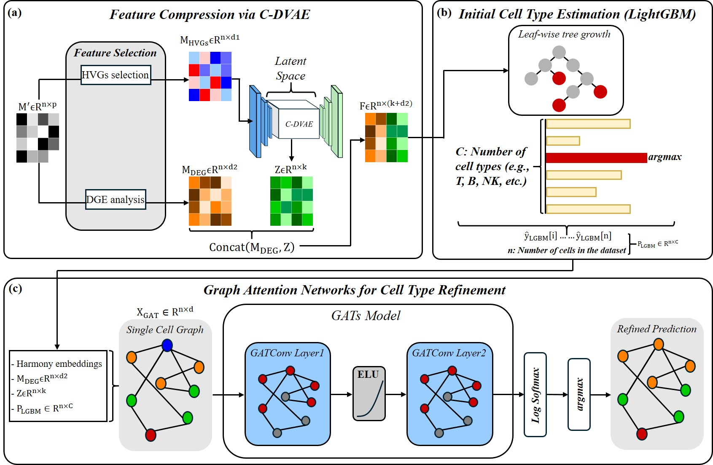

# scLightGAT: A LightGBM-based Framework Integrating C-DVAE and GATs for Robust Single-cell RNA-seq Cell Type Annotation

scLightGAT is a supervised reference-to-query framework for single-cell RNA-seq cell-type annotation. It combines a contrastive denoising variational autoencoder (C-DVAE), a LightGBM classifier, and a graph attention network (GAT), allowing expression-derived features, discriminative marker genes, and local cell-neighborhood information to contribute to the final prediction.

During reference training, scLightGAT selects differentially expressed marker genes and up to 3,000 highly variable genes from the labelled reference data only. The C-DVAE learns a 128-dimensional latent representation using reconstruction, KL-divergence, and supervised contrastive objectives. LightGBM combines marker-gene expression with this latent representation to produce initial class probabilities; out-of-fold probabilities are used when fitting the downstream GAT. A two-layer residual GAT then refines the initial predictions using marker-gene expression, latent features, and LightGBM probabilities on a 10-nearest-neighbor graph built in PCA space, with Harmony correction when valid batch metadata are supplied.

The fitted feature schemas and model components are reused for independent query datasets. Query genes are aligned to the reference DGE and HVG schemas, missing genes are imputed with reference-derived means, and each query graph is constructed independently from query expression and optional batch metadata without using query cell-type labels. The initial LightGBM labels are retained in `adata.obs["scLightGAT_rawpred"]`, while the GAT-refined annotations and class probabilities are stored in `adata.obs["scLightGAT_pred"]` and `adata.obsm["annotation_scores"]`.



## Prerequisites

- Linux with Bash
- Git
- A Conda distribution, such as Miniconda or Anaconda
- Python 3.10, installed through the Conda environment below
- Optional: a CUDA-capable NVIDIA GPU with a compatible NVIDIA driver for GPU acceleration. CPU execution is supported but may be slower.

### Input requirements

- A labelled reference dataset (`--train_path`) and one or more query datasets (`--test_path`) in AnnData (`.h5ad`) format. `--test_path` may point to a single file or a directory of `.h5ad` files.
- Quality-controlled, library-size-normalized, and `log1p`-transformed expression in `adata.X` and `adata.layers["log_transformed"]`. The reference dataset must also contain raw counts in `adata.layers["counts"]`.
- A reference cell-type column in `adata.obs`, specified with `--train_celltype`. Query labels are optional and are used only for evaluation.
- Batch columns are optional and can be specified with `--train_batch` and `--test_batch`; use `None` when batch information is unavailable.

## Installation

scLightGAT is implemented in Python. Clone the repository and create the Conda environment as follows:

```bash
git clone https://github.com/chenh2lab/scLightGAT
cd scLightGAT
conda create --name scLightGAT python=3.10
conda activate scLightGAT
python -m pip install -r requirements.txt
python -m pip check
```

## Data Availability

### Option 1: Manaul Download


### Option 2: Proprocessing in local


## Usage

Run scLightGAT from the repository root after completing the installation steps above.

If Conda is not available in `PATH`, specify its installation directory:

```bash
export CONDA_BASE="<conda_path>"
```

Run scLightGAT with the following command. Replace each value enclosed in angle
brackets (`<...>`) with the corresponding value for your dataset:

```bash
bash run_script.sh \
  --dataset_path "<dataset_path>" \
  --save_path "<result_path>" \
  --batch_key "<obs_batch_key>" \
  --celltype_key "<obs_celltype_key>" \
  --n_runs "<repeat_time>"
```

`--dataset_path` and `--save_path` are required. `--batch_key`,
`--celltype_key`, and `--n_runs` are optional and default to `batch`,
`celltype`, and `5`, respectively. The batch and cell-type keys must
correspond to columns in `adata.obs`.

## Reproducing the Experiments

### Tested configuration

- OS: Ubuntu 22.04.5 LTS
- CPU: Intel Xeon Gold 6240L
- GPU: NVIDIA RTX A5000
- NVIDIA driver: 535.288.01
- Python: 3.10.20
- PyTorch: 2.2.1+cu121

### Shared dataset parameters

The scRNA-seq experiments use the following shared dataset parameters. Use these values wherever the commands below contain the corresponding placeholders:

| `<dataset_name>` | `<obs_batch_key>` | `<obs_celltype_key>` |
| --- | --- | --- |
| `immune` | `batch` | `final_annotation` |
| `lung` | `batch` | `cell_type` |
| `pancreas` | `tech` | `celltype` |

### Experiment list

| Experiment | Description |
| --- | --- |
| [Main experiment](#main-experiment) | Compares the batch-effect correction performance of scSCI with that of existing supervised and unsupervised methods. |
| [Ablation study](#ablation-study) | Evaluates how within-batch positive weighting, network depth, and activation functions affect scSCI performance. |

#### Main experiment

The main experiment uses the three scRNA-seq datasets from the scIB benchmark described in the Data Availability section. We compare ground-truth-guided scSCI with five unsupervised methods (Harmony, Scanorama, scVI, Seurat, and scCobra), two label-guided methods (scANVI and SMNN), and scDML as a separate cluster-number-guided comparison method. Raw is included as an uncorrected baseline. For scDML, the ground-truth number of cell types is supplied as the expected number of clusters. The comparison figures also include scSCI guided by the provided manual annotations.

Before running the experiment, create the method-specific Conda environments by following the instructions in [`benchmark/README.md`](benchmark/README.md). Run scSCI and the comparison methods for each dataset, saving their outputs under the same dataset-specific result directory.

Run scSCI:

```bash
bash run_script.sh \
  --dataset_path "<dataset_path>" \
  --save_path "<result_path>/<dataset_name>" \
  --batch_key "<obs_batch_key>" \
  --celltype_key "<obs_celltype_key>" \
  --n_runs "<repeat_time>"
```

Run the comparison methods:

```bash
bash benchmark/run_script.sh \
  --dataset_path "<dataset_path>" \
  --save_path "<result_path>/<dataset_name>" \
  --batch_key "<obs_batch_key>" \
  --celltype_key "<obs_celltype_key>" \
  --n_runs "<repeat_time>"
```

Repeat both commands for the `immune`, `lung`, and `pancreas` datasets. These dataset names must be used because the plotting scripts use them to locate the corresponding results.

To reproduce the complete comparison figures, also run [Manual annotation Option 1](#option-1-use-the-provided-manual-annotations) for all three datasets, using the same dataset-specific result directories.

The plotting scripts identify the ground-truth-guided scSCI results as `GT`. After all scSCI runs for a dataset have finished, rename its result directory:

```bash
mv -T \
  "<result_path>/<dataset_name>/scSCI" \
  "<result_path>/<dataset_name>/GT"
```

After scSCI and all comparison methods have finished, activate the `scSCI` environment and generate the metric bar charts and UMAP panels. For each method, the UMAP script automatically selects the run with the highest NMI score.

```bash
conda activate scSCI

python3 bar_chart.py \
  --result-dir "<result_path>" \
  --output-dir "<plot_root>/bar_chart"

python3 plot_umap.py \
  --result-dir "<result_path>" \
  --output-dir "<plot_root>/umap"
```

#### Ablation study

This experiment evaluates three design choices in scSCI while keeping the remaining preprocessing, training, and evaluation settings unchanged:

- **Within-batch positive weight:** `alpha` values from `0.0` to `1.0` in increments of `0.1`. The default scSCI setting is `0.1`; `1.0` gives equal weight to within- and cross-batch positive pairs and is reported as "Without weighting."
- **Encoder depth:** one (`512`), two (`512, 256`), or three (`512, 256, 128`) hidden layers with the Tanh activation and `alpha=0.1`.
- **Activation function:** Sigmoid, Tanh, or ReLU with the three-layer encoder and `alpha=0.1`.

Run every ablation condition for all three datasets from the repository root:

```bash
bash experiments/ablation/run_script.sh all \
  --dataset immune "<immune_dataset_path>" batch final_annotation \
  --dataset lung "<lung_dataset_path>" batch cell_type \
  --dataset pancreas "<pancreas_dataset_path>" tech celltype \
  --save_path "<result_path>/ablation" \
  --plot_path "<plot_root>/ablation" \
  --run_times "<repeat_time>"
```

Each `--dataset` occurrence supplies the dataset name, H5AD path, batch key, and cell-type key, in that order. For each dataset, the runner evaluates 11 within-batch weights, three encoder depths, and three activation functions. Per-run results are written to `<result_path>/ablation/<dataset_name>/<condition>/<run_id>/`.

The runner automatically generates all six ablation figures after finishing each dataset, so no separate plotting command is required. The figures and their corresponding figure-data CSV files are written to `<plot_root>/ablation/<dataset_name>/`: the five-metric `alpha` panel, the encoder-depth panel, two activation-function panels, and the biological-conservation and batch-correction weighting panels.

## Citation

Citation information for scSCI will be added once the associated manuscript is published or a DOI becomes available.

## References

[1] Malte D. Luecken, M. Büttner, K. Chaichoompu, A. Danese, M. Interlandi, M. F. Mueller, D. C. Strobl, L. Zappia, M. Dugas, M. Colomé-Tatché, and Fabian J. Theis. 2022. Benchmarking atlas-level data integration in single-cell genomics. Nature Methods 19, 1 (Jan. 2022), 41-50. https://doi.org/10.1038/s41592-021-01336-8.

[2] Bowen Zhao, Kailu Song, Dong-Qing Wei, Yi Xiong, and Jun Ding. 2025. scCobra allows contrastive cell embedding learning with domain adaptation for single cell data integration and harmonization. Communications Biology 8, 1 (Feb. 2025). https://doi.org/10.1038/s42003-025-07692-x.

<!-- # scLightGAT: A LightGBM-based Framework Integrating C-DVAE and GATs for Robust Single-cell RNA-seq Cell Type Annotation

## Overview
We propose **scLightGAT**, a Python-native, biologically informed, and computationally scalable framework for cell-type annotation. scLightGAT combines machine learning and deep learning techniques through a three-stage architecture:
1. **C-DVAE**: Contrastive Denoising Variational Autoencoder extracts low-dimensional latent features from highly variable genes (HVGs).
2. **LightGBM**: A gradient-boosted classifier uses the fused latent (Z) and DGE marker (M_DGE) features for an initial cell-type prediction.
3. **GATs**: Graph Attention Networks refine LightGBM’s output by modeling neighborhood interactions on a single-cell graph (SCG).


---

## Installation

```bash
git clone https://github.com/chenh2lab/scLightGAT.git
cd scLightGAT
pip install -r requirements.txt
pip install -e .
```

## Data Availability & Setup

The training and testing datasets for scLightGAT are hosted on Hugging Face.

**Option 1: Preprocessing in Local**
Using this option, will download data from GEO database and ot

Recommand python vesrion 3.10
```bash
```

```python
```

**Option 2: Manual Download**
Download manually from [Hugging Face Datasets](https://huggingface.co/datasets/Alfiechuang/scLightGAT) and place the folders in `data/scLightGAT_data/`.

**Option 3: Python Access**
```python
from huggingface_hub import hf_hub_download
import scanpy as sc

path = hf_hub_download(repo_id="Alfiechuang/scLightGAT", filename="Integrated_training/train.h5ad", repo_type="dataset")
adata = sc.read_h5ad(path)
```

---

## Quick Start (Shell Script)

We recommend using the provided wrapper script `run_sclight.gat.sh` for all operations. It handles environment setup (if configured) and simplifies argument passing.

### 1. Standard Training
Run on a specific dataset using default settings (DVAE=5 epochs, GAT=300 epochs):

```bash
./run_sclight.gat.sh GSE115978
```

Run on **all** available datasets:
```bash
./run_sclight.gat.sh
```

### 2. Hyperparameter Optimization (Optuna)
To automatically tune parameters (LightGBM, DVAE, GAT) for maximum accuracy on your training data:

```bash
# Recommended: 20-30 trials
./run_sclight.gat.sh --optimize --optuna-trials 20 sapiens_full
```
This runs the **scLightGAT Optimization Pipeline**, displaying progress bars for each model and saving the best parameters to `dvae_optimization_results.json` and `gat_optimization_results.json`.

### 3. Hierarchical Classification (Subtypes)
For datasets requiring fine-grained annotation (CD4+T, CD8+T, B cells, Plasma, DC subtypes), use the `--hierarchical` flag:

```bash
./run_sclight.gat.sh --hierarchical GSE115978
```
*Requires `Celltype_subtraining` column in training data.*

### 4. CAF Mode (Cancer-Associated Fibroblasts)
Run training/testing on specific CAF datasets:

```bash
./run_sclight.gat.sh --caf
```

### 5. Inference-Only Mode
Skip training and use pre-trained models saved in `saved_models/`:

```bash
./run_sclight.gat.sh --inference-only GSE123139
```

---

## Advanced Usage

### Custom Ground Truth & Batch Keys
The pipeline automatically detects ground truth columns (e.g., `Manual_celltype`, `final_celltype`). You can also specify them manually:

```bash
./run_sclight.gat.sh --gt-key "My_Labels" --batch-key "sample_id" GSE153935
```

### Key Arguments
| Argument | Description | Default |
|----------|-------------|---------|
| `--dvae-epochs` | Epochs for C-DVAE | 5 |
| `--gat-epochs` | Epochs for GAT | 300 |
| `--optimize` | Enable Optuna optimization | False |
| `--optuna-trials`| Number of optimization trials | 10 |
| `--hierarchical` | Enable subtype prediction | False |
| `--caf` | Use CAF-specific data | False |
| `--inference-only`| Use pre-trained models | False |

---

## Experimental Results

Results are saved to `sclightgat_exp_results/<DATASET_NAME>/<TIMESTAMP>/`, containing:
- **`adata_with_predictions.h5ad`**: Final AnnData with `scLightGAT_pred`.
- **`accuracy_report.txt`**: Detailed accuracy metrics.
- **`umap_comparison.png`**: Side-by-side UMAP of Ground Truth vs scLightGAT.
- **`scLightGAT_run.log`**: Full execution logs (including debug info).
- **Optimization Results**: JSON files with best parameters (if optimization was run).

---

## Data Structure

### Training Data (`train.h5ad`)
- `.X`: Log-transformed expression matrix.
- `.obs['Celltype_training']`: Broad cell type labels.
- `.obs['Celltype_subtraining']`: Subtype labels (for Hierarchical mode).

### Test Data (`<dataset>.h5ad`)
- `.X`: Log-transformed expression matrix.
- `.obsm['X_umap']`: UMAP coordinates (automatically computed if missing).

---

## Authors
**Tsung-Hsien Chuang**, **Cheng-Yu Li**, **Liang-Chuan Lai**, **Tzu-Pin Lu**, **Mong-Hsun Tsai**, **Eric Y. Chuang***, and **Hsiang-Han Chen***

*Correspondence to: Hsiang-Han Chen (chenh2@ntnu.edu.tw) and Eric Y. Chuang (chuangey@ntu.edu.tw).*

---
© 2025 scLightGAT Team. All rights reserved. -->
